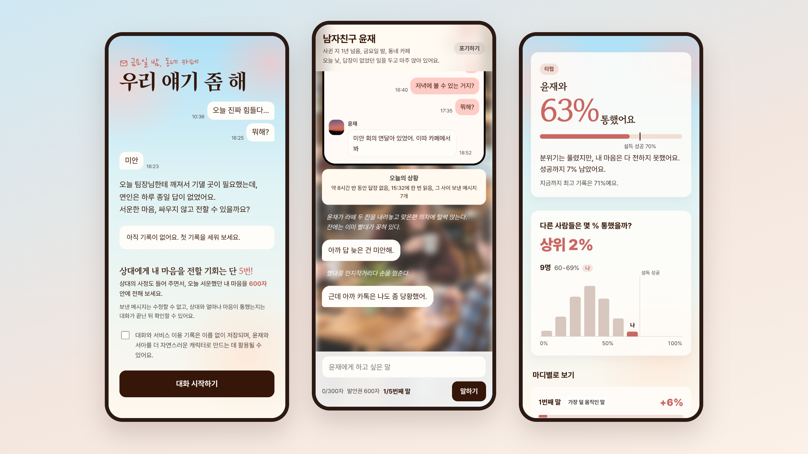
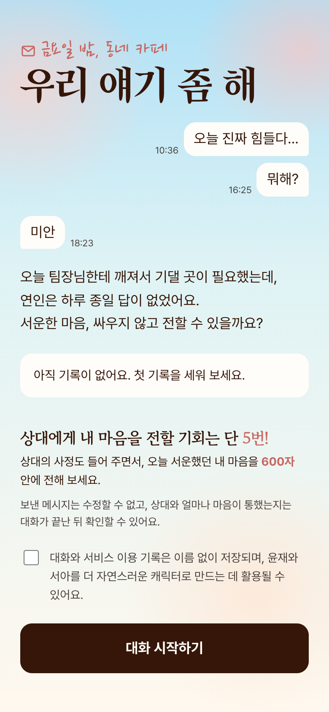
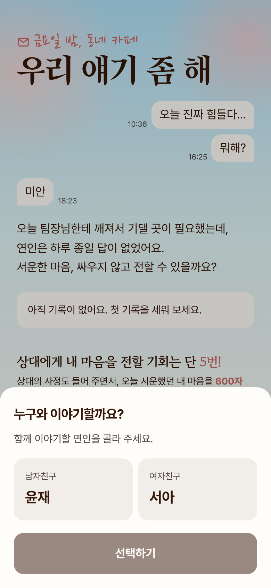
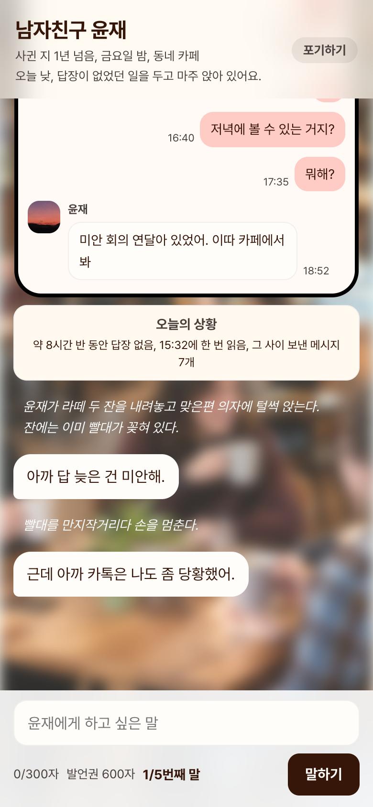
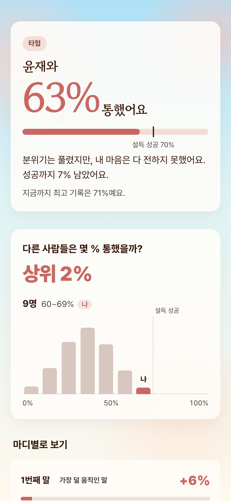
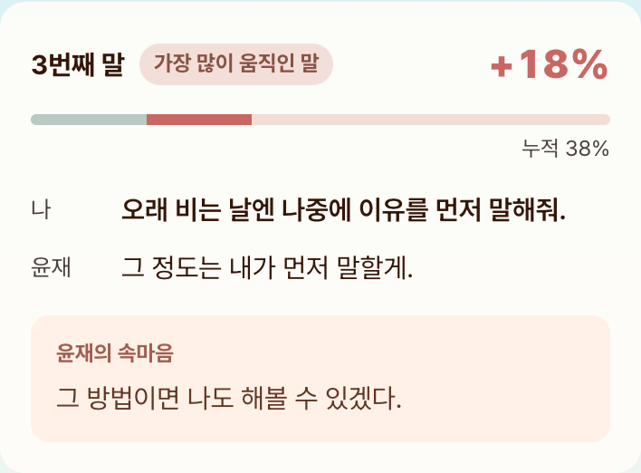
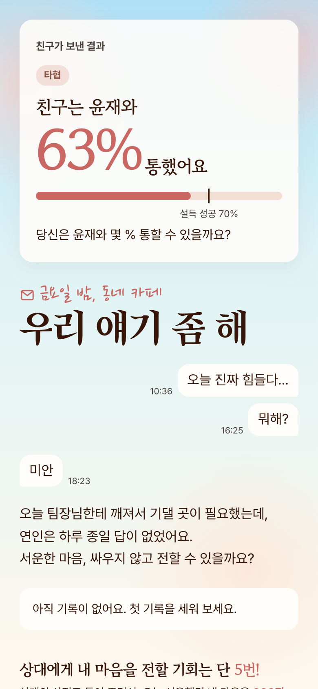
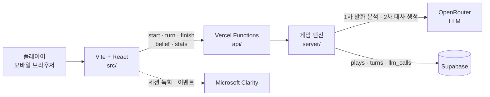
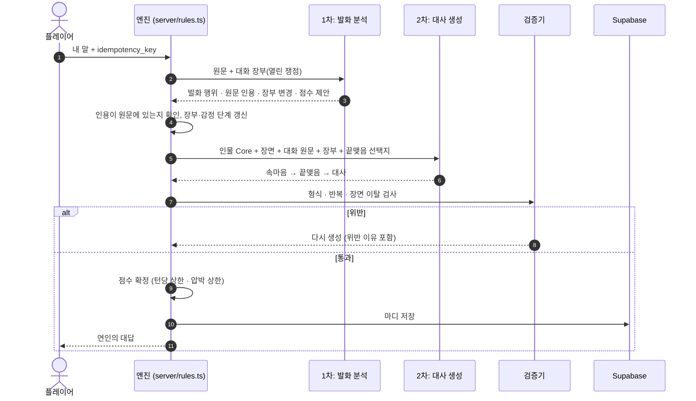

# 💬 우리 얘기 좀 해

> 서운한 건 말하고 싶은데, 싸우고 싶진 않아.
> 다섯 마디 안에 AI 연인과 서운함을 풀어 가는 대화 게임

<p align="left">
  <a href="https://persuasion.space"></a>
  
  
  
  
</p>



---

## ✨ 금요일 밤, 동네 카페

오늘 팀장님한테 깨져서 기댈 곳이 필요했는데, 연인은 하루 종일 답이 없었다.
"뭐해?"에 돌아온 건 여덟 시간 반 뒤의 "미안" 한 마디.
이제 카페에 마주 앉았다.

**상대의 사정도 들어 주면서, 오늘 서운했던 내 마음을 싸우지 않고 전할 수 있을까?**

말할 기회는 다섯 번, 쓸 수 있는 글자는 600자. 보낸 말은 고칠 수 없고, 상대의 마음이 얼마나 움직였는지는 대화가 끝난 뒤에야 알 수 있다.

---

## 📌 0. Overview

**우리 얘기 좀 해**는 AI 연인(남자친구 윤재 또는 여자친구 서아)과 다섯 마디 대화를 나누는 웹 게임이다. 대화가 끝나면 마디마다 연인의 마음이 몇 % 움직였는지, 대화 중에는 숨겨져 있던 연인의 속마음이 무엇이었는지 리포트로 공개된다.

- **서비스 URL**: https://persuasion.space
- **목적**: 사람들이 AI 캐릭터와 어떻게 대화하고 설득하는지 실제 데이터를 모으는 실험이다. 동시에 [relationship-engine](https://github.com/happy7yong/relationship-engine)에서 설계 중인 NPC 대화 구조("LLM은 제안, 엔진이 확정", 근거 있는 판단)를 실제 사람에게 먼저 시험해 보는 작은 판이기도 하다.

### 한 판의 흐름

| 단계 | 내용 |
| --- | --- |
| 1. 상황 | 하루 종일 답이 없던 연인과 카페에서 마주 앉는다 |
| 2. 연인 선택 | 남자친구 **윤재** / 여자친구 **서아**. 같은 장면, 다른 성격 |
| 3. 대화 | 다섯 마디 · 600자 안에서 대화한다. 점수는 화면에 보이지 않는다 |
| 4. 리포트 | 연인과 몇 % 통했는지, 마디별 마음 변화와 속마음, 다른 참가자들 사이의 위치 |
| 5. 공유 | "나는 윤재와 N% 통했다. 너는?" 결과 링크를 친구에게 보낸다 |

다섯 마디를 끝까지 한 뒤(일찍 끝나지 않는다) 70% 이상 통했으면 설득 성공, 30% 이상이면 타협이다.

---

## 🖼️ 1. Screens

| 시작 | 연인 선택 | 대화 |
| :---: | :---: | :---: |
|  |  |  |
| 오늘 있었던 일과 대화 규칙 | 윤재와 서아 중 한 명을 고른다 | 카톡 기록과 장면 묘사로 대화가 시작된다 |

| 결과 리포트 | 마디별 보기 | 친구가 보낸 결과 |
| :---: | :---: | :---: |
|  |  |  |
| 통한 정도와 참가자 분포 | 마디마다 오른 %와 연인의 속마음 | 공유 링크로 들어온 첫 화면 |

> 결과 리포트·마디별 보기 이미지는 개발용 예시 데이터(`/?dev=result`)로 찍었다. 참가자 분포는 실제 기록이 아니다.

---

## 👥 2. Development Info

- **개발 인원**: 1명 (개인 프로젝트)
- **역할**: 기획 · UI/UX · 프론트엔드 · 서버리스 API · 캐릭터·대화 엔진 설계 · 평가
- **개발 기간**: 2026.11.21 ~ 진행 중

---

## 🧱 3. Architecture

### 3-1. 시스템 구성



- 게임 상태는 서버가 AES-GCM으로 암호화한 토큰에 담아 화면에 준다. 화면은 이 토큰을 읽지도, 바꾸지도 못한다 (`server/token.ts`).
- 마음 지수(점수)는 플레이 중에 화면으로 보내지 않고 엔딩에서만 공개한다.

### 3-2. 한 마디가 처리되는 과정



자세한 설계는 [docs/dialogue-architecture.md](docs/dialogue-architecture.md).

---

## 🧠 4. 대화 엔진 설계 포인트

### LLM은 제안하고, 엔진이 확정한다

LLM은 점수를 "제안"만 한다. 한 마디로 오를 수 있는 최대치, 압박·반복으로만 이뤄진 말의 상한, 엔딩 판정은 모두 코드 규칙(`server/rules.ts`)이 정한다. 같은 말에 모델이 들쭉날쭉한 점수를 줘도 게임 규칙은 흔들리지 않는다.

### 사실은 엔진이, 말은 캐릭터의 마음에서

앞 단계(발화 분석)는 **무엇이 사실인지**만 정하고, 대사 모델이 **무엇을 느끼고 말할지** 정한다. "이 상태면 이렇게 말해라" 같은 지시 대신, 누가 무엇을 말하고 약속했는지를 대화 장부(`server/ledger.ts`)에 쌓아 넘긴다. 지켜야 할 것(반복 금지, 장면 이탈 금지)은 프롬프트 지시가 아니라 **검증기**(`server/checks.ts`)로 막고, 어기면 다시 생성한다.

### 캐릭터는 행동 규칙이 아니라 가치로

윤재·서아의 Core(`server/content.ts`)에는 "이럴 땐 이렇게 말한다"가 아니라 **무엇을 중요하게 여기는지**를 적었다(평가 이론, Appraisal Theory). 그래서 속마음에는 억울함이 남아 있어도, 그 순간 더 중요한 가치를 따라 반론 대신 "오늘은 네 얘기부터 듣자"라고 말할 수 있다. 설계 의도는 [docs/character-intent.md](docs/character-intent.md).

### 근거 있는 돌아보기

리포트 아래 "대화 돌아보기"는 연인이 대화를 어떻게 받아들였는지 정리한다. 판단마다 근거가 된 마디와 **플레이어가 실제로 한 말**을 붙이고, 원문에 없는 인용이나 MBTI·애착 유형 같은 진단 라벨은 코드가 거부한다 (`server/belief.ts`, [docs/belief.md](docs/belief.md)).

---

## 🔬 5. 평가와 개선

대화 품질(자연스러움, 캐릭터다움, 다섯 마디의 흐름)은 **사람이 최종 판단**한다. AI는 조건을 가린 비교표와 원인 분석 자료를 준비하고, 사람이 먼저 읽고 평가한 뒤에 내부 상태를 공개한다. 사람이 느낀 어색함은 바로 예외 규칙을 추가하는 수정 명령이 아니라, 원인을 조사할 관찰 데이터로 다룬다 ([docs/eval/conversation-quality-rules.md](docs/eval/conversation-quality-rules.md)).

```
실제 대화 확인 → 사람 평가 → 원인 분석 → 최소 수정 → 다시 확인
```

| 영역 | 문제 | 한 일 | 결과 |
| --- | --- | --- | --- |
| 대사 말투 | "인정 → 하지만 → 내 의도 해명"으로 정리된 GPT 같은 대사 | 원인을 프롬프트 6곳의 지시 중복으로 특정하고 2개 원칙으로 통합 | "무시한 것처럼" 6회 → 1회, 평균 길이 60자 → 47자 |
| 모델 | 배포 모델은 비싸고, 개발 모델은 말투가 어색함 | 같은 대본·같은 프롬프트로 3개 모델 비교 | 한 판 비용 $0.097 → $0.021 |
| 캐릭터 설계 | Core에 성격과 "행동 규칙"이 섞여 반응이 정해져 있음 | Core를 가치·믿음·민감점 중심으로 재구성 | 매번 반론하지 않고 가치에 따라 반응 |
| 감정 상태 | 사과를 거듭해도 캐릭터의 미안함이 오르지 않음 | 상태 규칙에 "사과하면 미안함 +1"만 추가 | 윤재가 먼저 "뭐가 제일 서운했어?"라고 물음 |
| 서비스 목적 | 실제 플레이어 대부분이 연인을 달래기만 함 | 문구를 "내 서운함을 싸우지 않고 전하기"로 정렬 | 배포 완료 |

전체 기록은 [docs/worklog-2026-11-23-24.md](docs/worklog-2026-11-23-24.md), 실험별 결과는 [docs/eval/](docs/eval/).

---

## 🛡️ 6. 실패와 중복 요청 처리

relationship-engine의 계약(`api.md`, `turn-lifecycle.md`, `trace-contract.md`)에서 가져온 규칙이다.

- **멱등 키:** 말하기 요청마다 화면이 `idempotency_key`(UUID)를 만든다. 응답을 못 받고 같은 말을 다시 보내면 같은 키를 쓰고, 서버는 LLM을 다시 부르지 않고 처음 결과를 돌려준다. 그 마디가 이미 다른 말로 기록돼 있으면 `409 turn_already_recorded`와 함께 기록된 대화(`resync`)를 돌려주고, 화면은 그걸 이어 붙인 뒤 새로 쓴 말을 입력창에 돌려준다. (Supabase 연결 시)
- **실패 규칙:** LLM 생성·검증 실패는 자동 재시도 1회 후 `502 generation_failed`. 상태는 바뀌지 않고, 대체 대사는 만들지 않는다. 화면은 "다시 보내기"를 띄운다.
- **저장이 먼저:** 마디는 Supabase에 저장된 뒤에만 화면에 보낸다. 저장에 실패하면 `503 service_unavailable`.
- **시간 예산:** 시도마다 하드 타임아웃을 두고, 재시도까지 합쳐 Vercel 함수 상한(60초) 안에 끝난다 (`server/model-config.ts`).
- **출력 형식:** strict `json_schema`로 강제하고 Zod로 다시 검증한다. 추론은 끈다(`reasoning: none`).
- **오류 형식:** `{ error: { code, message, retryable } }`. 코드 목록은 `server/http.ts`.
- **Trace:** 실패한 시도까지 원문 요청·응답, 모델, 토큰·비용, 걸린 시간, 결과를 `llm_calls`에 응답 뒤 따로 저장한다. API 키는 저장하지 않는다.
- **새로고침:** 화면 상태는 sessionStorage에 있어 새로고침해도 이어진다. 토큰이 만료되면 "처음부터 다시 하기"를 띄운다.

---

## 🛠️ 7. Tech Stack

| 항목 | 기술 |
| --- | --- |
| Frontend | React 18, TypeScript 5, Vite 5 |
| API | Vercel Functions (`api/*.ts`, 리전 `bom1`, 최대 60초) |
| LLM | OpenRouter — 대사 `openai/gpt-5.6-luna`, 발화 분석·장면 판정·돌아보기 `openai/gpt-5.4-mini` |
| 검증 | Zod, strict `json_schema` |
| DB | Supabase (PostgreSQL) |
| 분석 | Microsoft Clarity (세션 녹화, 이벤트) |
| 테스트 | Vitest (23개 파일, 179개 테스트) |
| 폰트 | Pretendard, Gowun Batang, Nanum Pen Script, Song Myung |

모델은 환경 변수(`FRAME_MODEL`, `NPC_DIALOGUE_MODEL`, `NPC_MODEL`)로 바꿀 수 있다.

---

## 📂 8. 폴더 구조

```
persuasion-game/
├─ src/                    # 화면 (시작 → 연인 선택 → 대화 → 리포트)
├─ api/                    # Vercel Functions: start · turn · finish · belief · stats · feedback · headline
├─ server/
│  ├─ rules.ts             # 게임 규칙과 점수 확정 (턴당 최대치, 압박 상한, 엔딩 판정)
│  ├─ content.ts           # 장면, 윤재·서아 Core, 평가 기준
│  ├─ npc.ts               # 1차 발화 분석 · 2차 대사 생성 호출과 출력 검증
│  ├─ ledger.ts            # 대화 장부: 누가 무엇을 말하고 약속했나
│  ├─ checks.ts            # 검증기: 반복 · 장면 이탈 · 형식
│  ├─ belief.ts            # 대화 돌아보기: 근거 있는 판단과 인용 검사
│  ├─ report.ts            # 저장된 대화로 리포트 생성 (LLM 호출 없음)
│  ├─ token.ts             # 게임 상태 AES-GCM 토큰
│  ├─ llm.ts, model-config.ts   # OpenRouter 호출, 호출별 설정·타임아웃·재시도·기록
│  └─ store.ts, sync.ts    # Supabase 저장, 멱등 처리, 기록으로 상태 따라잡기
├─ scripts/                # 터미널 플레이 · 말투 확인 · 평가 · 로그 추출
├─ supabase/schema.sql     # plays · turns · llm_calls
└─ docs/                   # 설계 문서와 평가 기록
```

---

## 🚀 9. 로컬 실행

```bash
npm install
cp .env.example .env   # OPENROUTER_API_KEY가 비어 있으면 대본 모드로 동작
npm run dev
npm test
```

- **대본 모드:** API 키 없이 화면만 확인할 때 쓴다. 대사는 정해진 문장이라 실제 대화 품질과 다르다.
- **채팅 화면 미리보기:** `/?dev=chat`에서 샘플 대사를 추가하며 말풍선을 확인한다. 게임 기록이나 AI를 쓰지 않는다.
- **리포트 미리보기:** `/?dev=result` (예시 리포트), `/?dev=shared` (친구가 보낸 결과 화면).
- 실제 게임과 미리보기 모두 Enter는 줄바꿈이고 `말하기` 버튼으로만 전송한다.

### 개발 도구

| 명령 | 하는 일 |
| --- | --- |
| `npm run play` | 웹과 같은 서버 코드로 터미널에서 윤재와 대화 (서아: `npm run play -- f`). Supabase에 기록하지 않는다 |
| `npm run tone` | 정해 둔 첫마디 5개에 대한 대답을 한 번에 출력 |
| `npm run eval` | 고정 입력으로 엔진을 돌려 지표를 기준선으로 남긴다 (`replay`, `cross`, `scene`, `value` 등) |
| `npm run logs` | 운영 DB의 플레이를 읽기 좋은 대화록(markdown)으로 `logs/`에 뽑는다. 읽기만 한다 |

`npm run play` 중 `/again`은 방금 대답을 같은 말로 다시 생성하고(말투 비교용), `/prompt`는 모델에 들어간 프롬프트를, `/quit`은 종료한다. `play`·`tone`·`eval`은 `.env` 또는 `.env.local`에 `OPENROUTER_API_KEY`가 있어야 실제 모델로 동작한다.

---

## ☁️ 10. 배포 (Vercel)

1. Vercel에서 이 레포를 Import한다. Framework는 Vite로 자동 인식된다.
2. Environment Variables에 `SESSION_SECRET`(16자 이상 랜덤), `OPENROUTER_API_KEY`를 넣는다. 모델을 바꾸려면 `FRAME_MODEL`(발화 분석), `NPC_DIALOGUE_MODEL`(대사)을 지정한다. `NPC_MODEL`을 지정하면 모든 호출에 같은 모델을 쓴다.
3. 로그를 모으려면 Supabase SQL Editor에서 `supabase/schema.sql`을 실행하고 `SUPABASE_URL`, `SUPABASE_SERVICE_ROLE_KEY`, `MAX_TOTAL_PLAYS`를 넣는다. 이걸 연결해야 참가자 통계가 보이고, 같은 토큰으로 마디를 다시 보내거나 엔딩을 반복 생성하는 것도 막힌다.
4. OpenRouter 콘솔에서 크레딧 한도를 걸어 두면 비용 사고를 막을 수 있다.
5. 선택: [Microsoft Clarity](https://clarity.microsoft.com) 프로젝트 ID를 `VITE_CLARITY_ID`에 넣고 다시 배포한다. 녹화는 `play_id` 태그로 Supabase `plays.id`와 맞춰 볼 수 있고, 결과(`outcome`, `shake`)와 이벤트(`turn_sent`, `ending_shown`, `error_*` 등)로 거를 수 있다. 채팅 말풍선은 녹화에 보이게 해 두었고(`data-clarity-unmask`), 입력창에 치는 중인 글자는 Clarity가 항상 가린다.

---

## 📊 11. 수집하는 데이터

| 테이블 | 내용 |
| --- | --- |
| `plays` | 결과, 최종 점수, 마디 수, 사용 글자 수, 게임을 미리 들었는지 여부, 엔딩, 대화 돌아보기와 그에 대한 피드백 |
| `turns` | 플레이어 발언 원문, 연인 응답, 제안 점수와 확정 점수, 전략 라벨, 모델과 토큰 사용량·비용, 프롬프트 버전 |
| `llm_calls` | LLM 시도별 원문 요청·응답과 실패 사유 (분석·디버깅용) |

대화와 이용 기록은 이름 없이 저장되며, 시작 화면에서 동의를 받은 경우에만 게임을 시작할 수 있다. 외부 참가자를 받기 전에 보관 기간과 삭제 방법을 정해 둔다.

---

## 📚 12. Docs

| 문서 | 내용 |
| --- | --- |
| [dialogue-architecture.md](docs/dialogue-architecture.md) | NPC 대화 구조 재설계: 상태는 사실로, 말은 마음에서 |
| [character-intent.md](docs/character-intent.md) | 윤재·서아 캐릭터 설계 의도와 현재 구현 점검 |
| [belief.md](docs/belief.md) | 연인이 플레이어를 판단하는 기능과 근거 검사 |
| [appraisal-review.md](docs/appraisal-review.md) | 캐릭터가 직접 듣고 해석하는 구조 검토 |
| [worklog-2026-11-23-24.md](docs/worklog-2026-11-23-24.md) | 대화 품질·모델·캐릭터 설계 개선 기록 |
| [eval/](docs/eval/) | 평가 규칙과 실험별 결과 |
