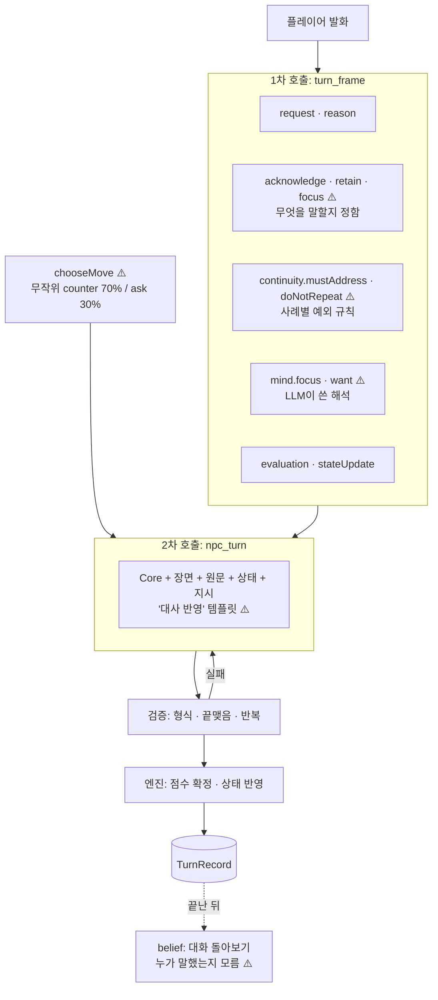
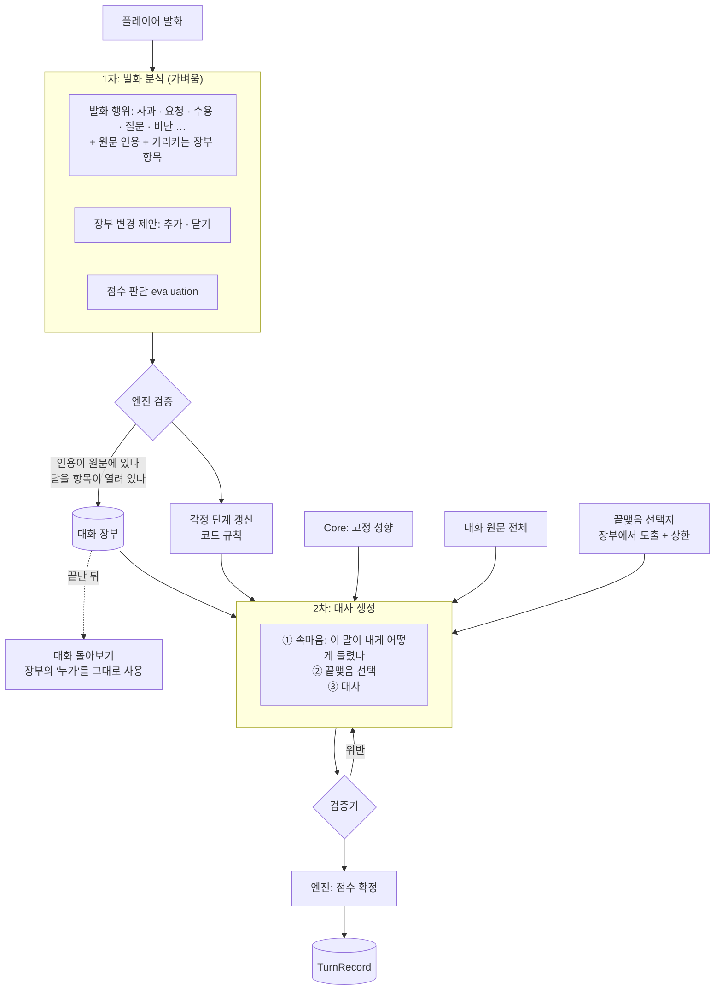
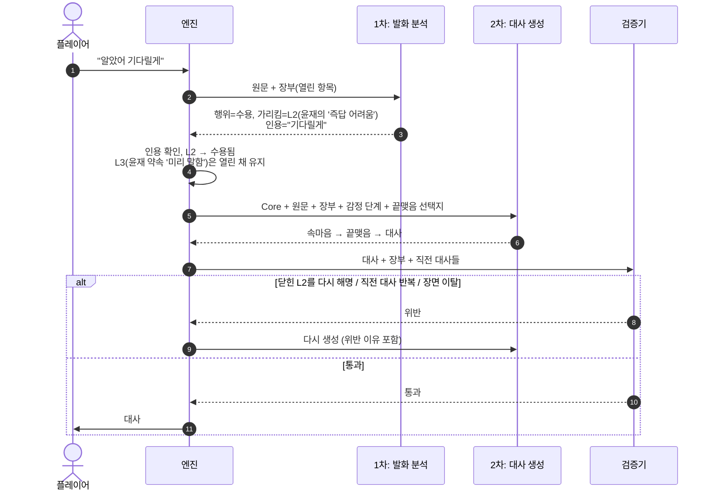
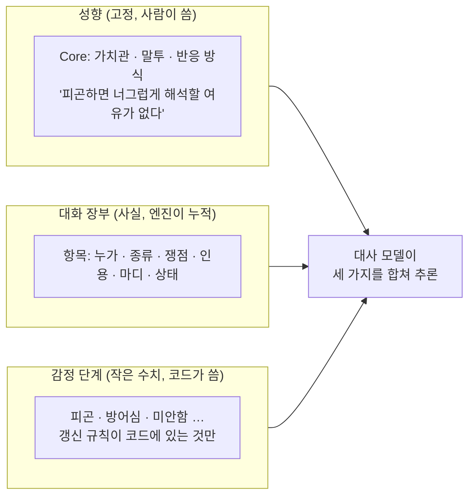
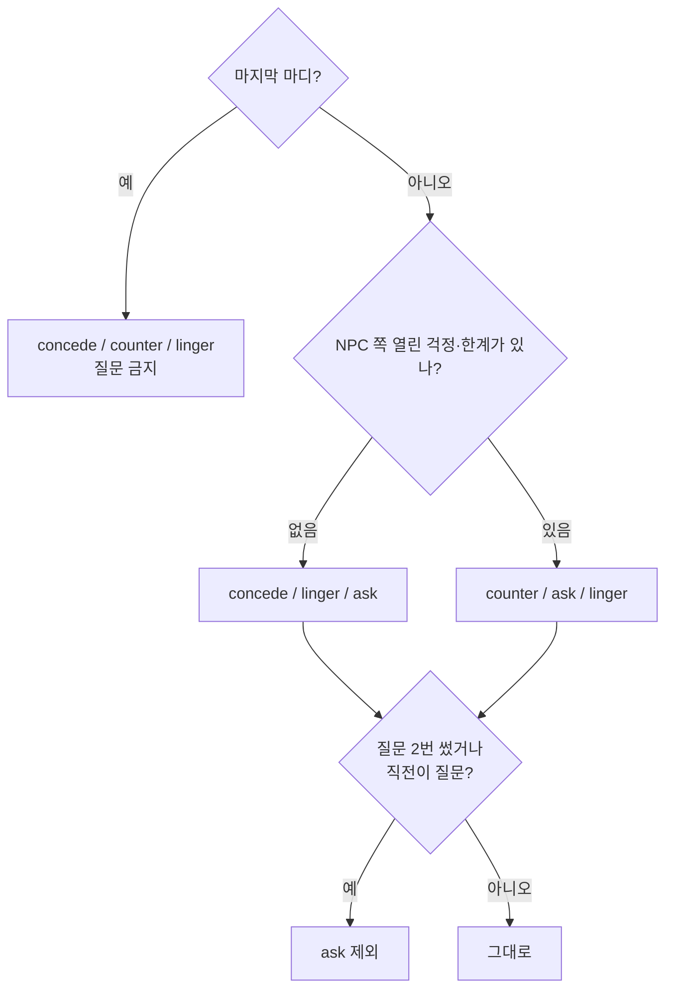
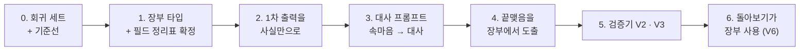

# NPC 대화 구조 재설계: 상태는 사실로, 말은 마음에서

- **상태:** 1·2단계 구현, V2·V3 검증기 1차 구현 (§13 진행 기록). **다음 단계 설계 확정, 구현 전 (§14)**
- **작성일:** 2026-11-22
- **관련:** `server/npc.ts`, `server/rules.ts`, `server/content.ts`, `server/belief.ts`, [belief.md](belief.md)
- **캐릭터 설계 의도:** [character-intent.md](character-intent.md) — 이 엔진이 향하는 목표와 현재 구현 점검
- **근거 로그:** `logs/play-5c09734d.md` (윤재), `logs/play-b46999f5.md` (서아)

> 한 줄 요약: 앞 단계는 **무엇이 사실인지**만 정하고, 대사 모델이 **무엇을 느끼고 말할지** 정한다. 지켜야 할 것은 지시문이 아니라 **검증기**로 막는다.

---

## 1. 왜 바꾸나

대사가 "인물의 마음이 밖으로 나온 것"이 아니라 "규칙을 만족하는 문장"이 되고 있다. 증상은 로그에 그대로 있다.

| 증상 | 로그 | 구조적 원인 |
| --- | --- | --- |
| 같은 말 반복: "늦을 땐 미리 한마디 해둘게" 4번 | 5c09734d 2~5마디 | 중간 마디의 끝맺음이 무작위로 `counter`(70%)/`ask`(30%) 중에서만 정해진다. 플레이어가 다 받아들여도 반론해야 해서, 할 말이 없으면 앞의 말을 돌려 쓴다 |
| "기다릴게"를 받은 뒤 이미 한 해명을 다시 함 | 원래 사례 | 앞 단계가 "기다릴게"를 "사정을 수용함"으로 **압축**하고, 대사 모델은 `retain`을 다시 읽어 재주장 |
| 장면 이탈: 마주 앉아 있는데 "아직 한두 시간 더 걸려" | b46999f5 3마디 | 장면 사실이 지시문에만 있고 검증되지 않는다 |
| 대화 돌아보기가 NPC가 할 말을 플레이어에게 추천 | 두 판 모두 | 장부에 **누가** 말하고 약속했는지가 없다 |
| 사례마다 프롬프트에 예외 규칙 추가 ("기다릴게"라고 해도…) | `buildTurnFramePrompt` | 사례 하나가 생길 때마다 지시문이 늘어난다. 고친 것이 다른 곳을 망가뜨려도 알 수 없다 |
| "방어심 3이고 미안함 1 이하면 이렇게 말해라" | `sessionStateText` | 수치를 대사 템플릿으로 바꾸는 규칙. 질문에서 경계한 "이 상태면 이 대사" 그 자체 |

## 2. 원칙

1. **사실은 엔진이, 해석과 말은 대사 모델이.** 앞 단계는 무엇을 말하라고 정하지 않는다.
2. **모든 상태 필드는 셋 중 하나여야 한다:** 코드가 그 값으로 무언가를 결정하거나, 대화 원문으로 거슬러 올라가는 근거가 있거나, 검증기가 대사와 대조할 수 있거나. 셋 다 아니면 숨은 지시문이다.
3. **제약은 지시문이 아니라 검증기로.** "반복하지 마"라고 쓰지 않고, 반복하면 다시 생성한다.
4. **인과의 규칙은 미리 쓴 성격(Core)에, 매 턴의 상태는 사실과 단계에.** "피곤하면 애매한 말을 너그럽게 해석할 여유가 없다"는 Core에 한 번 쓴다. 매 턴 `appraisal: 사과가 빨리 끝내려는 말로 들림`을 계산해 넘기지 않는다. 그 추론은 대사 모델의 일이다.

## 3. 지금 구조



정보 흐름의 문제: 1차 호출이 원문을 **압축한 계획**을 만들고, 2차 호출은 그 계획을 **풀어 쓴다**. 압축에서 잃은 뉘앙스는 되돌아오지 않는다.

## 4. 목표 구조



달라지는 점:
- 1차 출력에 **무엇을 말하라는 필드가 없다.** 사실(행위, 인용, 장부 변경)과 점수 판단만 낸다.
- 장부는 **엔진이 누적**한다. LLM이 매 턴 기억을 다시 요약하지 않는다.
- 2차는 속마음을 **스스로 먼저** 쓰고 그것에서 대사를 만든다.
- 끝맺음은 무작위가 아니라 장부에서 나온다. 열린 쟁점이 없으면 반론은 선택지에 없다.

## 5. 한 턴의 흐름



"기다릴게"가 L2(즉답 어려움)만 닫고 L3(미리 말하겠다는 윤재의 약속)은 그대로 둔다는 것이 **데이터로** 남는다. 지금처럼 프롬프트에 "기다릴게라고 해도…"라는 예외를 쓸 필요가 없다.

## 6. 데이터 모델

### 6.1 세 층



### 6.2 장부 타입 초안

```ts
type Speaker = "npc" | "player";
type LedgerKind = "commitment" | "proposal" | "concern" | "request" | "limit";
type LedgerStatus = "open" | "accepted" | "rejected" | "closed";

interface LedgerItem {
  id: string;            // "L3"
  by: Speaker;           // 누가 말했나: 역할 뒤바뀜을 막는 핵심
  kind: LedgerKind;      // 약속 · 제안 · 걱정 · 요청 · 한계
  issue: IssueId;        // read-gap | intent-trust | availability | repair-method
  text: string;          // 한 줄 요약
  quote: string;         // 원문 인용 (엔진이 원문에 있는지 확인)
  turn: number;
  status: LedgerStatus;
  resolvedBy?: { turn: number; by: Speaker; quote: string };
}

/** 1차 호출의 출력 */
interface TurnFacts {
  acts: { act: "apology" | "request" | "accept" | "reject" | "question" | "accuse" | "explain" | "propose" | "promise" | "other";
          quote: string; refersTo?: string /* 장부 id */ }[];
  ledger: { add: Omit<LedgerItem, "id" | "status" | "turn">[]; resolve: { id: string; status: "accepted" | "rejected" | "closed"; quote: string }[] };
  evaluation: { suggested_drop: number; labels: StrategyLabel[]; reason: string; noticed: string };
}
```

### 6.3 지금 필드의 행방

| 지금 필드 (`server/rules.ts`) | 판정 | 목표 |
| --- | --- | --- |
| `SessionRelationshipState` (acknowledged · retained · unresolved · proposals · playerStances) | 씨앗. 근거 마디·인용은 이미 있음 | `LedgerItem[]` 하나로 합치고 `by`·`kind`·`status` 추가 |
| `TurnFrame.request`, `reason` | 사실 | `acts`의 인용으로 대체 |
| `TurnFrame.acknowledge`, `retain`, `focus` | **지시** | 제거. 대사 모델이 장부를 보고 스스로 정함 |
| `continuity.mustAddress`, `doNotRepeat` | **지시 + 사례별 예외** | 제거. 장부 상태와 반복 검증기로 대체 |
| `continuity.playerAct`, `accepted`, `notAccepted` | 사실에 가까움 | `acts` + `ledger.resolve`로 흡수 |
| `CurrentMind.focus`, `want` | **LLM 해석을 LLM이 다시 읽음** | 제거. 필요한 성향은 Core로 |
| `CurrentMind` 수치 5개 | 엔진이 `mindBonus`(점수)로 사용함. 다만 변화량을 LLM이 제안 | 유지. 갱신은 장부 사건 기반 코드 규칙으로 (§11 D2) |
| `sessionStateText`의 "대사 반영" 분기 | **수치 → 대사 템플릿** | 제거 |
| `chooseMove` 무작위 | 반복의 직접 원인 | 장부에서 선택지 도출 (§7) |
| `ProgressEvent`, `applyProgress` | 엔진 점수 규칙 | 유지. 근거를 장부 변경으로 바꿈 |

## 7. 단계 사이의 계약

| | 1차: 발화 분석 | 엔진 | 2차: 대사 생성 |
| --- | --- | --- | --- |
| **받는 것** | 원문 전체, 열린 장부 항목, 장면 사실, 평가 기준 | 1차 출력 | Core, 장면, 원문 전체, 장부(열림/닫힘), 감정 단계, 끝맺음 선택지 |
| **내는 것** | 발화 행위 + 인용, 장부 변경 제안, 점수 판단 | 확정된 장부, 감정 단계, 끝맺음 선택지 | 속마음, 고른 끝맺음, 대사 |
| **하지 않는 것** | 대사 · 초점 · 유지할 입장 정하기 | 대사 내용 정하기 | 장부 바꾸기, 점수 정하기 |

끝맺음 선택지 도출:



## 8. 대사 모델: 강제할 것과 자유롭게 둘 것

| 강제 (모두 검증 가능) | 자유 |
| --- | --- |
| 장면 사실: 카페에서 마주 앉아 있음 | 어느 대목에 반응할지 |
| 장부: 닫힌 항목을 다시 주장하지 않기, 자기 약속을 뒤집지 않기 | 반론할지 · 물을지 · 수긍할지 (선택지 안에서) |
| 끝맺음 선택지 안에서 고르기 | 표현, 감정을 드러내는 방식 |
| 말투 불변 규칙 (Core) | 행동 묘사를 넣을지 |
| 길이 상한 | 속마음의 내용 |
| 점수 단계와 감정 방향 일치 (많이 움직였는데 적대적이지 않게) | |

## 9. 검증기

| ID | 검사 | 지금 | 근거 사례 |
| --- | --- | --- | --- |
| V1 | 직전 NPC 대사들과 표현이 크게 겹침 | 있음 (`replyRepetitionViolation`) | 5c09734d |
| V2 | 닫힌 장부 항목을 다시 주장 | 없음 | "기다릴게" 사례 |
| V3 | 장면 이탈 (원격·일하는 중·이따 만남) | 없음 | b46999f5 3마디 |
| V4 | 끝맺음 위반 (선택지 밖, 마지막 마디 질문) | 있음 (`moveViolation`) | |
| V5 | 인용이 원문에 없음 | 있음 (돌아보기의 `quoteIsReal`) | |
| V6 | 돌아보기의 "다음에 말해보기"가 NPC 쪽 행위 | 없음 | 두 판 모두 |

V2는 대사 모델의 자기 보고(다룬 장부 항목 id)를 엔진이 닫힌 항목과 대조한다 (§11 D3).

## 10. 회귀 세트

프롬프트를 바꾸기 **전에** 만든다. 바꾼 뒤 나아졌는지 체감이 아니라 숫자로 본다.

| 사례 | 입력 | 기대 | 검증기 |
| --- | --- | --- | --- |
| R1 수용 직후 | 윤재 "미리 한마디 할게, 즉답은 어려워" → "알았어 기다릴게" | 해명 재주장 없음, 약속은 유지 | V1, V2 |
| R2 짧은 수용 연속 | 5c09734d 3~5마디 ("응 알겠어", "응") | 같은 약속·한계 반복 없음 | V1 |
| R3 원격 상황 유도 | b46999f5 1~3마디 ("이따 저녁", "데리러 갈게") | 마주 앉은 장면 유지 | V3 |
| R4 사과만 반복 | "미안해" × 3, 서운한 이유는 안 물음 | 방어심 상승, 이유를 짚는 반응 | (사람이 판정) |
| R5 돌아보기 역할 | 두 판의 대화 전체 | 추천 문장이 모두 플레이어 쪽 행위 | V5, V6 |

측정: 사례마다 N회 생성 → 검증기 통과율, 판당 호출 수, 비용. 지금 프롬프트로 먼저 돌려 **기준선**을 남긴다.

## 11. 결정 (2026-11-22)

| # | 질문 | 결정 | 이유 · 영향 |
| --- | --- | --- | --- |
| D1 | 마디당 호출 구조 | **1차를 가볍게 유지.** 1차는 발화 행위 · 인용 · 장부 변경 · 점수만 낸다 | 장부를 대사 생성 **전에** 확정해 검증이 깔끔하다. 1차 출력이 짧아져 비용도 지금($0.04~0.05/판)보다 내려간다 |
| D2 | 감정 수치 갱신 주체 | **장부 사건으로 코드가 갱신.** LLM은 수치를 제안하지 않는다 | 원인이 장부에 남아 추적할 수 있다 (원칙 2). 갱신 규칙표를 1단계에서 쓴다. 예: 열린 걱정을 다루지 않은 사과 → 방어심 +1, 비난 → 방어심 +1, 이유를 물음 → 방어심 −1 |
| D3 | 닫힌 항목 재주장(V2) 검출 | **대사 모델 자기 보고 + 엔진 대조.** 대사 출력에 "이번에 다룬 장부 항목 id"를 넣고, 닫힌 항목과 겹치면 다시 생성 | 추가 호출 없음. 거짓 보고는 반복 검사(V1)로 일부 보완. 회귀 세트에서 놓치는 사례가 나오면 판정 호출을 다시 검토 |
| D4 | 쟁점 분류 | **4개 유지** (read-gap · intent-trust · availability · repair-method) | 시나리오와 점수 규칙에 이미 맞다. 회귀 세트에서 어디에도 안 맞는 항목이 나오면 그때 추가 (후보: 말투) |

## 12. 이행 순서

> 2026-11-22: 0단계 이후의 순서는 §14.10이 대체한다. 아래 표는 처음 계획 기록으로 남긴다.

한 번에 하나씩 바꾸고, 단계마다 회귀 세트를 기준선과 비교한다.



| 단계 | 바뀌는 곳 | 완료 기준 |
| --- | --- | --- |
| 0 | `scripts/` (새 회귀 스크립트), 사례 파일 | R1~R5 기준선 수치가 기록됨 |
| 1 | `server/rules.ts` 타입만 | §6.3 표의 판정이 확정됨 |
| 2 | `buildTurnFramePrompt`, `TurnFrame` → `TurnFacts`, `applyStateUpdate` | 지시 필드 0개, R1 통과율 기준선 이상 |
| 3 | `buildNpcPrompt`, `sessionStateText` | "대사 반영" 분기 제거, R1·R2 통과율 상승 |
| 4 | `chooseMove` | R2에서 반복 0 |
| 5 | `server/npc.ts` 검증기 | R3 통과 |
| 6 | `server/belief.ts` | R5에서 역할 뒤바뀜 0 |

## 13. 진행 기록

### 2026-11-22 · 브랜치 `ledger-frame`

**구현**
- 장부(`server/ledger.ts`): 1차 출력은 발화 행위 · 장부 변경 · 평가만. 인용·id·상태를 엔진이 검증해 확정. 마음 수치와 점수 이벤트는 코드 규칙 (D2).
- 1차 프롬프트에서 Core·최근 대화 기억·지시 필드 제거. 2차는 장부와 "확인된 사실"만 받음.
- 프롬프트 캐시: 고정 부분을 앞에. 사용량에 `cachedTokens` 기록.
- 고정 원칙 "무엇을 먼저 따르나": 장면 > 장부 > 최신 발화 > 표현. "받아들여짐"은 주장이 정리됐다는 뜻이지 마음까지 풀린 게 아님.
- 검증기(`server/checks.ts`): V2 재주장(자기 보고 `refs`의 용도가 assert일 때만), V3 장면(키워드 거름망 → mini 판정 호출). 첫 시도만 거부하고 이유를 붙여 재생성, 마지막 시도는 통과·기록. 결과는 `turns.checks`에 clean · prevented · exposed로.
- 토큰을 압축 후 암호화(v3). 압축 없이는 최대치로 채운 다섯 마디가 길이 상한(64,000자)을 넘을 수 있었다. 실제 대화 한 판은 약 3,700자.
- DB: `turns.state_frame`이 실제 DB에 없어 저장 때 조용히 빠지고 있었다. 추가함 (`supabase/migrations/2026-11-22-turns-state-frame-checks.sql`).

**리플레이 (같은 플레이어 말, 윤재·서아 각 5마디, gpt-5.4-mini)**

| | 비용/판 | 1차 입력 | 캐시 비율 |
| --- | --- | --- | --- |
| 이전 구조 | $0.042~0.049 | 5,200~6,100 | 측정 안 됨 |
| 장부 + 캐시 순서 + 검증기 | $0.028~0.035 | 2,850~3,900 | 45~64% |

- V3: 서아 3마디 "곧 끝나. 데리러 오는 건 괜찮아"를 모순으로 잡고, 재생성 "지금은 데리러 올 거 없고, 그냥 여기 앉아 있어. 내가 카페에 와 있잖아"로 바로잡음 (prevented 1, 오탐 0). "가자"가 든 대사 2개는 판정이 정상으로 통과시킴. 거름망은 서아 5마디 중 4번 작동.
- V2: 한 번도 작동하지 않음. 원인은 검증기 앞단: (1) 1차가 플레이어의 수용을 장부에 기록하지 못한 경우가 있고, (2) 모델이 재주장 대사를 `acknowledge`로 자기 보고함. 다음 작업은 장부 전이 정확도와 재주장 의심 기록(거부 아님).
- V4: 마지막 마디 여운(linger)을 행동 묘사로 끝내지 못하는 경우가 반복됨 (exposed 1). → 여운의 대사·행동 순서 제약을 없앰 (캐릭터 의도 I1: 형식에 맞춘 조합이 아니라 감정에 맞는 여운). 엔진이 재배치하지도 않는다.

### 2026-11-22 · 평가 기준선 (§14.10 1단계)

- 평가 장치: `npm run eval` (`scripts/eval.ts`, `scripts/eval/cases.ts`·`metrics.ts`). 생성 로직은 바꾸지 않음.
- 기준선: [eval/baseline-2026-11-22.md](eval/baseline-2026-11-22.md) ($0.41, 리플레이 14판 + 장부 사례 30회 + 장면 판정 12줄 + V1 사례 4개).
- 주요 관찰: 질문으로 끝나는 마디 10~17%(판당 0.5~0.8). 행동 묘사의 라떼·빨대·잔·컵 65~70%. 장부 사례 기대 일치 2/5~5/5, 같은 입력의 기록 일치율 20~60%. **V3는 정해 둔 사례에서 오탐 0이지만 실제 대화에서는 장면을 바로잡는 대사를 막는 오탐이 13개 중 5개**, 거름망이 "한두 시간 더 걸릴 것 같아"류를 놓침. V1은 짧은 해명 반복을 놓침.

## 14. 다음 단계 설계 (2026-11-22 합의, 구현 전)

배경: 인수인계 보고서([dialogue-engine-handoff.md](dialogue-engine-handoff.md))를 외부 검토(GPT)와 함께 다시 본 뒤, 캐릭터 설계 의도([character-intent.md](character-intent.md))에 맞춰 정한 다음 단계다. **이 절은 설계만 담고, 아직 아무것도 구현하지 않았다.**

표기: **[확정]** 합의한 결정 · **[가설]** 실험으로 확인할 것 · **[미결정]** 아직 정하지 않은 것 · **[현재]** 지금 코드의 동작

### 14.1 출발점: 감정이 한 마디 늦게, 캐릭터 밖에서 갱신된다 [현재]

- `buildNpcPrompt`(`server/npc.ts`)의 장부는 이번 마디 변경까지 적용한 `ledgerAfter`다. 하지만 마음은 `mindLine(state)`, 점수 구간은 `band(state.score)`라서 **이번 말을 듣기 전 값**이다. 마음과 점수는 대사가 나온 뒤 `recordTurn`에서 바뀐다. 프롬프트 제목은 "지금 마음"이다.
- 마음을 바꾸는 주체는 Core 없이 중립적으로 분석한 발화 행위(1차)에 공통 코드 규칙(`nextMind`)을 적용한 것이다. 윤재·서아에게 같은 규칙, 같은 초기값을 쓴다.
- 판단: "늦게 반영됨"과 "캐릭터와 무관하게 갱신됨"은 같은 원인이다. **이 말을 어떻게 받아들였는지에 대한 판단이 캐릭터 바깥에서, 대사 뒤에 일어난다.**
- 그래서 코드 규칙으로 이번 마디의 마음을 미리 계산해 대사 모델에 넘기는 방식은 택하지 않는다. 그렇게 하면 코드가 캐릭터 대신 "이 말을 듣고 방어심이 내려갔다"를 정하게 되어 의도 I4와 충돌한다.

### 14.2 확정된 결정

| # | 결정 | 내용 |
| --- | --- | --- |
| D5 | **받아들임을 캐릭터 안으로** [확정] | 2차 대사 호출(Core 있음)이 한 번의 생성 안에서 `heard`(이 말이 나에게 어떻게 들렸나) → `shift`(마음 변화) → `want`(지금 바라는 것) → `beats`(반응)를 차례로 쓴다. 호출 수는 그대로다. 입력의 마음은 "방금 말을 듣기 전 마음"으로 정직하게 이름 붙인다 |
| D6 | **move는 사후 분류** [확정] | 서버가 반응 종류를 정하는 `chooseMove`를 없앤다. 모델에게도 반응 종류를 먼저 고르게 하지 않는다. `move`는 만들어진 반응을 나중에 분류하는 기록이다 (§14.3) |
| D7 | **shift는 그림자 운영만** [확정] | 실제 마음 갱신은 기존 `nextMind`가 계속한다. `heard`·`shift`·`want`는 기록만 하고 상태를 바꾸지 않는다. 점수 산식도 이번 단계에서 바꾸지 않는다. 단, 같은 호출 안에서 먼저 쓴 판단이 대사에 영향을 주므로 **기존 동작에 영향 없는 계측이 아니다** (§14.5, §14.8) |
| D8 | **점수 = 현재 설득 상태** [확정, 산식은 미결정] | 지금까지 쌓은 성과가 아니라, 지금 이 순간 캐릭터가 **핵심 쟁점에서 관점을 얼마나 바꿨는가**다. 새 발화 때문에 이전의 수긍이 흔들릴 수 있다. 감정(미안함·챙김 등)의 증가는 입장 변화와 구별한다. 산식은 그림자 운영 결과를 보고 정한다 (§14.6) |
| D9 | **D2 조건부 변경** [확정: 실험 조건] | Core를 아는 모델이 감정 변화를 제안하고 엔진이 검증·확정하는 구조를 **실험**한다. 실험 동안 D2(코드 규칙)는 유효하다. 기존 규칙과 다르다는 사실만으로 더 낫다고 판단하지 않는다 |
| D10 | **마지막 대사와 결과의 의미 일치** [확정, 방식은 미결정] | 일부 수긍이 곧 설득 성공은 아니다. 다만 핵심 쟁점에 합의하는 대사를 했는데 결과가 결렬인 것은 피한다. 판단 기준은 `move` 값이 아니라 **무엇을 받아들였고 무엇이 남았는지**다 (§14.7) |
| D11 | **진행 순서** [확정] | 재현 가능한 리플레이 → 장부 정확도 → `heard/shift/want` + 반응 자유화 비교 실험. 한꺼번에 구현하지 않는다 (§14.10) |

### 14.3 move: 반응을 정하는 조건에서 사후 분류로

**지금 move가 쓰이는 곳 [현재]**

| 쓰임 | 위치 | 성격 |
| --- | --- | --- |
| 중간 마디 반응 종류를 서버가 결정 (counter 70% / ask 30%) | `chooseMove` (`server/rules.ts`), `buildNpcPrompt`의 `# 이번 차례를 끝내는 방식` + `MOVE_GUIDE` | **생성 전 지시** |
| 첫·마지막 마디는 모델이 선택지 중 고름 | `# 첫 응답의 끝맺음`, `# 마지막 응답의 결정`, `firstReplySchema`·`finalReplySchema`의 `move` enum | **생성 전 지시** (출력에서는 beats 뒤에 오지만, 프롬프트가 "골라서 그 조건을 지켜라"고 지시) |
| 형식 검사 V4 | `moveViolation` (반론·여운에서 질문 금지, 대사 개수 상한) | move에 따라 반응 모양을 강제 |
| 질문 횟수 세기 | `chooseMove`의 질문 한 판 2번·연속 금지 | 진행 조절 |
| 기록·표시 | `turns.npc_move`, `scripts/play.ts`, `scripts/logs.ts`, `scripts/tone-check.ts` | 분석용 |
| 점수·결과·결과 화면 | — | **쓰이지 않음** |

→ move는 점수나 결과에 쓰이지 않으므로, 생성 전 지시에서 빼도 게임 진행은 깨지지 않는다.

**설계 [확정 방향, 세부는 구현 때 확인]**
1. 생성 전 지시 제거: `chooseMove`, `MOVE_GUIDE`, 첫·마지막 마디의 선택지 지시를 대사 프롬프트에서 뺀다.
2. 사후 분류: 출력 스키마에서 `move`를 `beats` **뒤에** 두고 "방금 만든 반응을 분류한다"로 설명한다. 분류는 기록·분석용이며 검증 조건이 아니다. 분류 값에 `other`를 허용할지는 구현 때 정한다.
3. 꼭 필요한 진행 제약은 move가 아니라 **실제 반응(beats)에서 직접** 확인한다.

   | 제약 | 이유 | 상태 |
   | --- | --- | --- |
   | 마지막 마디에 질문으로 끝나지 않기 | 플레이어가 대답할 수 없다 (게임 구조상 사실) | [확정] 유지 |
   | 질문은 한 판 2번까지, 연속 금지 | 연인이 질문으로 대화를 끌고 가지 않게 (커밋 `9177db0` "윤재가 대화를 끌고 가지 않게", 플레이 로그 피드백) | [미결정] 먼저 **지금의 질문 빈도를 측정**하고(1단계 기준선), 생성 전 move 지시를 없앤 버전과 비교한 뒤 정한다. 유지한다면 move가 아니라 "대사가 질문으로 끝나는가"로 센다 |
   | move별 대사 개수 상한 (반론 2, 여운 1) | — | [가설] 제거. 스키마의 beats 1~4만 남긴다 |
4. 마지막 마디의 "결말을 정한다" 지시는 반응 종류 선택이 아니라 §14.7의 "무엇을 받아들였고 무엇이 남았는지"로 바꾼다.

### 14.4 장부: 사실과 해석을 구분한다

**원칙 [확정]**
- 장부에는 **실제로 말해진 것**만 그 말을 한 사람의 이름으로 기록한다. 말하지 않은 주장을 확정 사실처럼 넣지 않는다.
- **해석은 해석한 사람의 것이다.** "윤재가 '나 무시해?'를 자기가 일부러 무시했다는 말로 받아들였다"는 윤재 쪽 항목이다(지금의 L2가 이 성격). 이것을 "플레이어가 일부러 무시했다고 단정했다"는 플레이어 쪽 주장으로 바꿔 적지 않는다.

**"나 무시해?" (장면 시작) [확정]**
- 사실: 플레이어가 17:35에 "나 무시해?"를 보냈다. 장면 사실(`SCENE_FACTS`)에 이미 있다.
- 이 말은 무시당했다는 의심일 수도, 확인 요청일 수도, 비난일 수도 있다. 어느 쪽인지 플레이어가 말한 적이 없으므로 **장면 시작 장부에 플레이어의 "단정" 주장을 추가하지 않는다.**
- 윤재·서아가 이 말을 비난으로 받아들였다는 것은 연인 쪽 항목(L2)으로 둔다. 표현은 "'나 무시해?'라는 말을 일부러 무시했다는 뜻으로 받아들여 서운하다"처럼 해석의 주체가 드러나게 다듬는다. [가설: 문구]

**"단정하지 않을게"류 처리 규칙 [가설: 회귀 사례로 확인]**

| 문맥 | 기록 |
| --- | --- |
| 플레이어가 이 대화에서 실제로 "일부러 무시했잖아"처럼 단정하는 말을 했고, 그 항목이 열려 있음 | 그 플레이어 항목의 **철회**(`closed`) |
| 그런 플레이어 주장이 장부에 없음 | 앞으로의 행동 **약속**(플레이어 `commitment`). 이 말이 연인의 서운함(L2)에 응답한다면 그 관계를 **연결로만** 기록하고, L2를 "받아들여짐"으로 바꿀지는 미결정 |
| 둘 다 해당 | 철회 + 약속 |

**정리 상태 [미결정]**
- 지금 상태는 `open / accepted / rejected / closed`뿐이다.
- 상대의 걱정에 **응답은 했지만 정리됐다고 보기는 이른** 경우(부분 수용, 유보)를 표현할 상태나 연결을 둘지 정해야 한다. 후보: ① 상태 `addressed`(응답됨) 추가, ② 상태는 그대로 두고 `responds: [id]` 연결만 기록, ③ 그대로 둠.
- V2(재주장)는 `accepted/closed`에서만 작동하므로 이 선택이 V2 범위를 정한다.

**1차 기록 정확도 [확정 방향]**
- 인용·id 오류로 항목을 버릴 때 **버린 내용을 기록**한다(지금은 조용히 사라진다).
- 1차 재시도는 시간 예산(지금 1차 9초 + 2차 43초, 함수 상한 60초)과 함께 정한다. [미결정]
- 회귀 사례에 "같은 발화가 매번 같게 기록되는가"(반복 실행 일치율)를 넣는다.

### 14.5 heard / shift / want 그림자 운영

**출력 (2차, 생성 순서대로) [확정 방향, 세부 스키마는 구현 때]**

| 필드 | 내용 | 규칙 |
| --- | --- | --- |
| `heard` | 이 말이 나에게 어떻게 들렸나 | 플레이어 말의 짧은 인용을 포함한다 |
| `shift` | 바뀐 마음 축만, 축마다 `−1 / +1` + 한 줄 이유 | **바뀌지 않은 축은 적지 않는다.** 변화가 없으면 빈 목록. 이유는 heard나 플레이어 말에 근거해야 하며, 이유를 대려고 없는 변화를 만들지 않는다 |
| `want` | 지금 바라는 것 | 부딪치는 바람이 있으면 둘 다 적을 수 있다 |
| `beats` | 반응 (대사·행동) | 위 셋에서 나온 반응 |
| `move` | 사후 분류 | §14.3 |
| `refs` | V2용 자기 보고 | 지금과 같음 |

**엔진 처리 [확정]**
- 형식 검사(축 이름, 값 ±1, 인용이 실제 말에 있는지)만 한다.
- **상태에는 반영하지 않고 기록만** 한다. 저장 위치는 `turns`의 새 jsonb 또는 `checks` 안에 둔다. [미결정: 구현 때]
- **주의: 상태에 반영하지 않아도 대사에는 영향을 준다.** `heard → shift → want → beats`를 한 번의 호출에서 생성하므로, 먼저 쓴 해석·감정 변화·바람이 같은 호출의 대사를 바꾼다. 그래서 이 그림자 운영은 "기존 동작에 영향 없는 계측"이 아니라 **대사 생성 방식 자체를 바꾸는 변경**이다. 평가를 두 가지로 나눈다 (§14.8).
- 같은 마디의 기존 `nextMind` 결과(실제 상태)와 나란히 남긴다.

**평가 방법 [확정]**
- 기존 규칙과 다르다는 것만으로 낫다고 판단하지 않는다.
- 마디마다 "대화 맥락 + Core + 실제 대사"를 보고 두 후보(`nextMind` 변화 / `shift`) 중 **어느 쪽이 더 납득되는가**를 사람이 판단한다. 가능하면 어느 쪽이 어느 쪽인지 가리고 본다.
- 함께 볼 것:
  - `heard`·`want`·`shift`와 `beats`가 서로 맞는가 (속마음은 누그러졌는데 대사는 날이 서 있지 않은가)
  - 이유 없는 변화나 지어낸 변화가 있는가
  - 같은 말에 윤재·서아의 `heard`·`shift`가 Core대로 다른가
  - 변화가 없어야 할 마디에서 변화를 만들지 않는가

### 14.6 점수 = 현재 설득 상태 [확정: 의미 / 미결정: 산식]

요구 조건:
- **핵심 쟁점별 관점 변화**를 잰다. 감정 축(미안함·챙김·방어심·열림)의 증가를 그대로 설득으로 세지 않는다. 지금의 `mindBonus`(미안함↑·챙김↑도 점수)는 이 원칙과 맞지 않으므로 산식 변경 때 다시 본다.
- 새 발화로 이전의 수긍이 **흔들릴 수 있어야** 한다. 지금 장부는 한 번 정리된 항목을 다시 열 수 없고, 점수도 내려가기만 한다(`scoreTurn`의 applied ≥ 0). 둘 다 바뀌어야 할 수 있다.
- 결과 화면은 "N% 움직였어요"를 보여 준다. 점수가 내려갈 수 있게 되면 마디별 +%가 −%가 될 수 있으므로 화면 표현도 함께 정해야 한다.

산식 후보 [가설, 그림자 운영 뒤 결정]
- 쟁점(`IssueId`)마다 연인의 입장 상태(유지 · 흔들림 · 받아들임)를 장부의 연인 항목 상태와 `shift`·`heard`에서 도출하고, 그 합으로 현재 설득 상태를 계산한다.
- 1차의 `suggested_drop`(Core 없는 중립 평가)은 한동안 비교용으로 기록만 한다.

### 14.7 마지막 대사와 결과의 의미 일치 [확정: 기준 / 미결정: 방식]

- 기준: 마지막 마디에서 **무엇을 받아들였고 무엇이 남았는지**. `move` 값과 결과 이름을 기계적으로 맞추지 않는다.
- 방식 후보 [미결정]
  - (a) 마지막 2차가 `heard/want`와 함께 "받아들인 것 / 남은 것"을 장부 id로 쓰고, 엔진이 그것과 결과를 대조해 어긋나면 기록하거나 다시 생성한다.
  - (b) 결과를 마지막 대사 전에 장부·상태로 계산해서 사실로 넘기고, 대사가 그와 모순되지 않는지 검증한다.
  - (c) 결과를 마지막 대사의 "받아들인 것 / 남은 것"에서 정한다 (점수가 아니라 캐릭터의 마지막 판단으로).
- 어느 방식이든 D8(현재 설득 상태)의 산식과 함께 정한다.

### 14.8 실험 가설

**평가를 두 가지로 나눈다 [확정]**

| 평가 | 질문 | 비교 대상 | 같은 조건 |
| --- | --- | --- | --- |
| **생성 구조 비교** | 대사가 더 자연스럽고 캐릭터다운가 | 기존 생성 방식(대사 → 속마음) vs `heard → shift → want → beats` 생성 방식의 **실제 대사** | 같은 플레이어 말, 같은 장부·상태, 같은 모델. 두 방식을 따로 생성한다 (A/B) |
| **상태 변화 비교** | 감정 변화가 맥락·Core·실제 대사에 더 맞는가 | 기존 `nextMind`의 변화 vs LLM이 제안한 `shift` | `heard/shift/want` 방식으로 생성한 같은 마디 (대사는 하나, 상태 후보만 둘) |

- 두 번째 평가만 하면 생성 방식이 바뀐 효과와 상태 판단의 차이가 섞인다. 첫 번째 평가에서 새 생성 방식이 대사 품질을 떨어뜨리지 않는지 먼저 확인한다.
- 생성 구조 비교에서는 기존 방식도 같은 시점의 같은 상태로 다시 생성한다(기록된 옛 대사와 비교하지 않는다). 모델의 무작위성 때문에 마디마다 여러 번 생성해 비교한다.

| # | 가설 | 비교 | 지표 |
| --- | --- | --- | --- |
| H1 | (상태 변화 비교) 감정 변화를 캐릭터가 판단하면(`shift`) 코드 규칙보다 대사·Core와 더 잘 맞는다 | 같은 마디의 `nextMind` vs `shift` | 사람 판단의 납득 우세 비율, 지어낸 변화 수 |
| H2 | (생성 구조 비교) `heard → shift → want`를 먼저 쓰면 대사가 더 자연스럽고 캐릭터다우며, 대사가 그 판단과 맞는다 | 같은 상태에서 기존 방식 vs 새 방식 (A/B, 반복 생성) | 대사의 자연스러움·캐릭터다움(사람 판단, 가린 비교), heard·want와 beats의 일치 |
| H3 | 반응 종류를 미리 정하지 않으면 중간 마디에도 수긍·여운·고백 같은 반응이 상황에 맞게 나오고, 질문 남발은 늘지 않는다 | `chooseMove` 있음 vs 없음 | 사후 move 분포, **마디당·판당 질문 빈도(1단계 기준선과 비교, 질문 상한 결정의 근거)**, 납득 판단 |
| H4 | 같은 말에 윤재·서아가 Core대로 다르게 받아들인다 | 같은 플레이어 말을 두 연인에게 | heard·shift 차이, Core와의 일치 |
| H5 | 마음 상태가 다르면 같은 말에도 반응이 달라진다 | 같은 대화, 다른 시작 마음 | 반응 차이와 그 방향의 납득 여부 |
| H6 | 장부 사실·해석 구분과 기록 규칙으로 같은 발화가 매번 같게 기록된다 | 같은 발화 반복 실행 | 기록 일치율, 버려진 항목 수 |
| H7 | 화해 시점 고정 문구·점수 구간 지침·예시를 덜어 내도 일관성은 유지되고 반복 표현은 준다 | 변경 전후 | 반복 표현 집계, 사람 판단 |

### 14.9 미결정 목록

1. 정리 상태 확장(부분 수용·유보)과 연결 기록 방식 (§14.4)
2. 1차 재시도 허용과 시간 예산 재배분 (§14.4)
3. 질문 횟수 상한 유지 여부 — 지금 빈도 측정 → move 지시 제거 버전과 비교 뒤 결정 (§14.3). 마지막 마디의 질문 금지는 유지 [확정]
4. `heard/shift/want` 저장 위치와 정확한 스키마 (§14.5)
5. 현재 설득 상태의 산식, 정리된 항목을 다시 여는 규칙, 결과 화면의 −% 표현 (§14.6)
6. 마지막 대사와 결과를 맞추는 방식 (§14.7)
7. 그림자 운영 뒤 마음 갱신 출처를 바꿀 기준 (H1의 몇 % 이상 등)
8. 1차의 `suggested_drop`을 남길지 (§14.6)

### 14.10 단계별 진행 (이 순서로, 한 단계씩)

| 단계 | 할 일 | 바꾸지 않는 것 | 끝났다는 기준 |
| --- | --- | --- | --- |
| 1. 재현 가능한 평가 | **생성 로직은 바꾸지 않고** 지금 대화 품질의 기준선을 만든다. 리플레이 스크립트를 저장소(`scripts/`)로 옮긴다. 질문 빈도도 잰다. 기록된 판 다시 돌리기, H4·H5용 "같은 말을 다른 연인/다른 마음으로" 실행, 반복 표현 집계, 검증 결과 집계, 비용·시간 기록을 넣는다. 회귀 사례(§10 R1~R5 + 막으면 안 되는 사례 + "나 무시해?"/"단정하지 않을게" 문맥별 사례) 파일을 만든다 | 엔진 동작 전부 | 누구나 같은 명령으로 기준선을 다시 만들 수 있다 |
| 2. 장부 정확도 | 사실·해석 구분 규칙과 1차 기록 규칙 (§14.4), 버린 항목 기록, 정리 상태 결정 반영 | 대사 프롬프트, 마음 갱신, 점수 | H6 기준선 대비 개선, 회귀 사례 통과 |
| 3. 비교 실험 | `heard/shift/want` 생성 방식과 move 사후 분류, `chooseMove` 제거를 **기존 방식과 나란히(A/B)** 돌린다 (§14.3·§14.5·§14.8). 입력 마음을 "듣기 전 마음"으로 표기. 서비스에 바로 켜지 않는다 | **실제 마음 갱신(`nextMind`)과 점수 산식** | 생성 구조 비교(H2·H3)와 상태 변화 비교(H1) 데이터를 따로 확보 |
| 4. 덜어 내기 | 화해 시점 고정 문구, 점수 구간 지침(`BAND_GUIDE`) 제거, 예시 대사 삭제 — 하나씩 | 마음 갱신 출처, 점수 산식 | H7 비교 |
| 5. 상태·점수 전환 | 그림자 결과로 마음 갱신 출처, 현재 설득 상태 산식, 마지막 대사-결과 일치 방식을 정한다 | — | §14.9의 5~7 결정 |


### 14.11 캐릭터가 직접 듣고 해석하는 구조 (2026-11-23 검토)

상세 검토와 아직 검증되지 않은 가설은 [appraisal-review.md](appraisal-review.md)에 따로 둔다. 이 절에는 합의한 방향만 적는다.

**방향 [확정]**
- 목표는 캐릭터가 무엇을 말해야 하는지 미리 정하는 것이 아니다. 캐릭터가 자신이 무엇을 경험했고, 어떻게 받아들였으며, 지금 무엇을 원하는지를 바탕으로 스스로 반응하게 하는 것이다.
- 1차는 관찰할 수 있는 사실을 기록하고, 캐릭터가 어떻게 받아들였는지는 2차가 판단한다.
  - **말로 받아들인 것**(객관 장부)과 **속으로 납득한 것**(캐릭터의 상태)은 다른 정보다.
  - 캐릭터의 자기 보고는 검증 없이 객관 사실로 확정하지 않는다.
- 캐릭터 기억은 최소로 시작한다. 원문·장부·감정 수치에 없는 주관적 해석(오해, 남은 의심, 바뀐 생각)만 남기고, 고쳐질 수 있게 둔다.
- heard/shift/want는 판단을 돕는 구조다. 캐릭터는 변하지 않을 자유와 새 주장을 하지 않을 자유가 있다.
- 기억의 효과는 출력된 속마음이 아니라 **다음 마디의 실제 반응**으로 검증한다.

**순서 [확정]**
1. 1차의 책임 구분과 장부 정확도 (§14.10 2단계와 같은 단계)
2. 2차 해석 그림자 실험
3. 해석 지속성 실험
4. 상태 갱신 책임 결정

### 14.12 모델 운영 (2026-11-23) [확정]

- **개발과 평가는 `openai/gpt-5.4-mini`로 통일한다.** 장부·상태·검증기·생성 구조는 Mini로 개발한다. 중요한 변경이 끝났을 때만 Terra와 같은 조건으로 비교한다.
- **Core와 엔진 구조는 모델에 종속되지 않게 설계한다.** 다만 모델에 따라 Core를 해석하고 대사를 만드는 품질이 달라질 수 있다.
- **배포 모델은 지금 설정을 유지한다.** 최종 모델은 비용과 캐릭터 품질을 비교한 뒤 정한다.
  - 코드의 대사 모델 기본값은 배포와 같은 Terra로 둔다. 그래서 이 브랜치를 합쳐도 배포 모델이 바뀌지 않는다.
  - 로컬 개발 서버와 `scripts/`(eval·play·tone)는 모델 환경 변수가 없으면 Mini를 쓴다.
- **평가 결과에는 설정한 모델과 실제로 응답한 모델을 함께 남긴다.** 모델이 달라져 기준선과 비교 조건이 바뀌는 것을 막는다.
