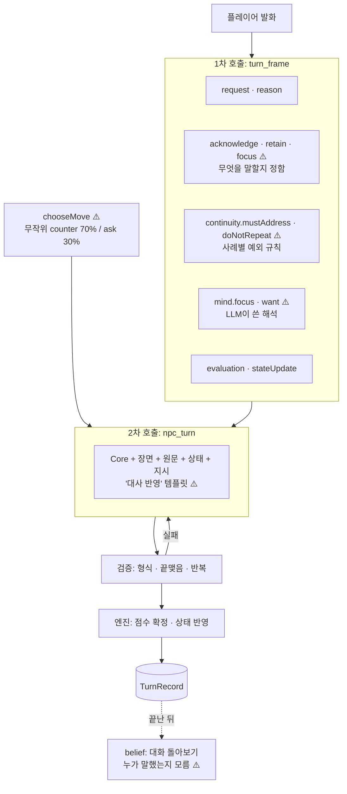
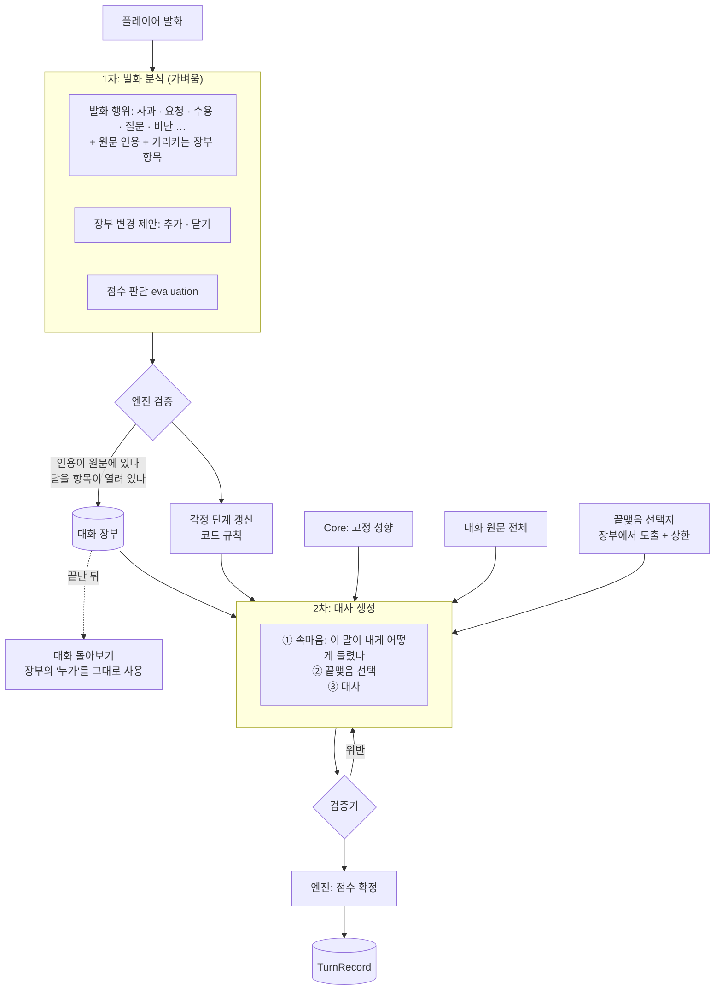
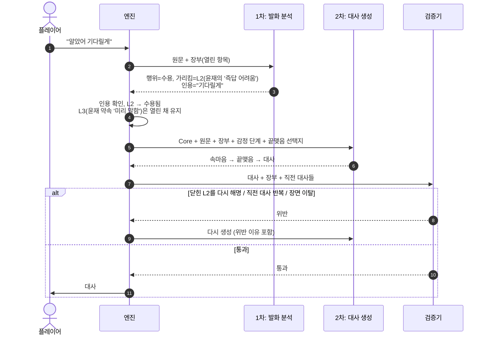
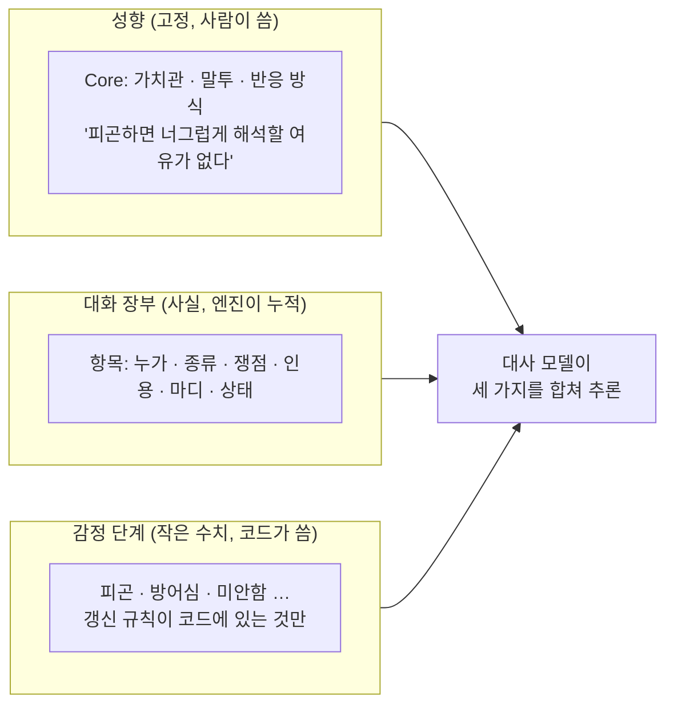
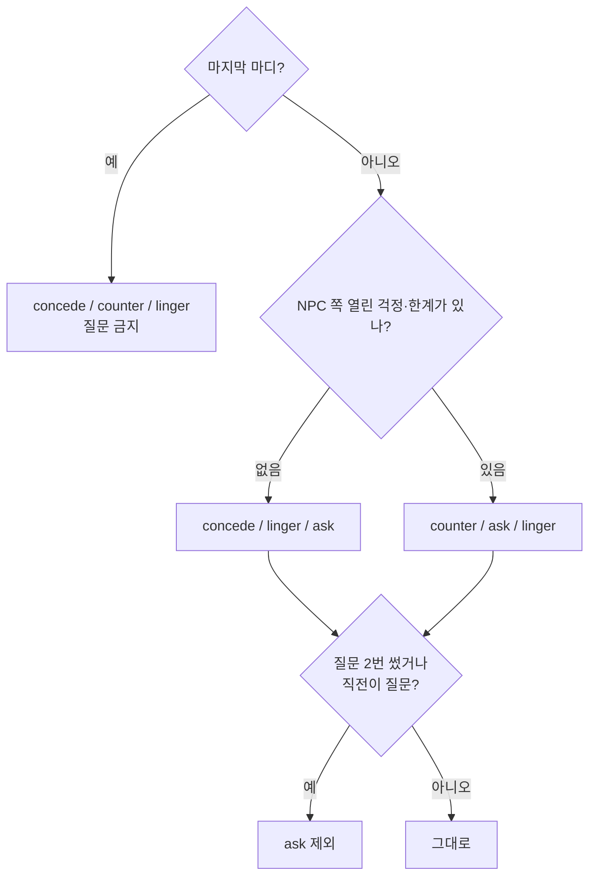
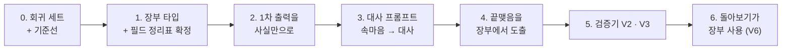

# NPC 대화 구조 재설계: 상태는 사실로, 말은 마음에서

- **상태:** 설계 확정 (§11 결정 완료), 0단계 착수 전
- **작성일:** 2026-11-22
- **관련:** `server/npc.ts`, `server/rules.ts`, `server/content.ts`, `server/belief.ts`, [belief.md](belief.md)
- **근거 로그:** `logs/play-5c09734d.md` (윤재), `logs/play-b46999f5.md` (서아)

> 한 줄 요약: 앞 단계는 **무엇이 사실인지**만 정하고, 대사 모델이 **무엇을 느끼고 말할지** 정한다. 지켜야 할 것은 지시문이 아니라 **검증기**로 막는다.

---

## 1. 왜 바꾸나

대사가 "인물의 마음이 밖으로 나온 것"이 아니라 "규칙을 만족하는 문장"이 되고 있다. 증상은 로그에 그대로 있다.

| 증상 | 로그 | 구조적 원인 |
| --- | --- | --- |
| 같은 말 반복: "늦을 땐 미리 한마디 해둘게" 4번 | 5c09734d 2~5마디 | 중간 마디의 끝맺음이 무작위로 `counter`(70%)/`ask`(30%) 중에서만 정해진다. 플레이어가 다 받아들여도 반론해야 해서, 할 말이 없으면 앞의 말을 돌려 쓴다 |
| "기다릴게"를 받은 뒤 이미 한 해명을 다시 함 | 원래 사례 | 앞 단계가 "기다릴게"를 "사정을 수용함"으로 **압축**하고, 대사 모델은 `retain`을 다시 읽어 재주장 |
| 장면 이탈: 마주 앉아 있는데 "아직 한두 시간 더 걸려" | b46999f5 3마디 | 장면 사실이 지시문에만 있고 검증되지 않는다 |
| 대화 돌아보기가 NPC가 할 말을 플레이어에게 추천 | 두 판 모두 | 장부에 **누가** 말하고 약속했는지가 없다 |
| 사례마다 프롬프트에 예외 규칙 추가 ("기다릴게"라고 해도…) | `buildTurnFramePrompt` | 사례 하나가 생길 때마다 지시문이 늘어난다. 고친 것이 다른 곳을 망가뜨려도 알 수 없다 |
| "방어심 3이고 미안함 1 이하면 이렇게 말해라" | `sessionStateText` | 수치를 대사 템플릿으로 바꾸는 규칙. 질문에서 경계한 "이 상태면 이 대사" 그 자체 |

## 2. 원칙

1. **사실은 엔진이, 해석과 말은 대사 모델이.** 앞 단계는 무엇을 말하라고 정하지 않는다.
2. **모든 상태 필드는 셋 중 하나여야 한다:** 코드가 그 값으로 무언가를 결정하거나, 대화 원문으로 거슬러 올라가는 근거가 있거나, 검증기가 대사와 대조할 수 있거나. 셋 다 아니면 숨은 지시문이다.
3. **제약은 지시문이 아니라 검증기로.** "반복하지 마"라고 쓰지 않고, 반복하면 다시 생성한다.
4. **인과의 규칙은 미리 쓴 성격(Core)에, 매 턴의 상태는 사실과 단계에.** "피곤하면 애매한 말을 너그럽게 해석할 여유가 없다"는 Core에 한 번 쓴다. 매 턴 `appraisal: 사과가 빨리 끝내려는 말로 들림`을 계산해 넘기지 않는다. 그 추론은 대사 모델의 일이다.

## 3. 지금 구조



정보 흐름의 문제: 1차 호출이 원문을 **압축한 계획**을 만들고, 2차 호출은 그 계획을 **풀어 쓴다**. 압축에서 잃은 뉘앙스는 되돌아오지 않는다.

## 4. 목표 구조



달라지는 점:
- 1차 출력에 **무엇을 말하라는 필드가 없다.** 사실(행위, 인용, 장부 변경)과 점수 판단만 낸다.
- 장부는 **엔진이 누적**한다. LLM이 매 턴 기억을 다시 요약하지 않는다.
- 2차는 속마음을 **스스로 먼저** 쓰고 그것에서 대사를 만든다.
- 끝맺음은 무작위가 아니라 장부에서 나온다. 열린 쟁점이 없으면 반론은 선택지에 없다.

## 5. 한 턴의 흐름



"기다릴게"가 L2(즉답 어려움)만 닫고 L3(미리 말하겠다는 윤재의 약속)은 그대로 둔다는 것이 **데이터로** 남는다. 지금처럼 프롬프트에 "기다릴게라고 해도…"라는 예외를 쓸 필요가 없다.

## 6. 데이터 모델

### 6.1 세 층



### 6.2 장부 타입 초안

```ts
type Speaker = "npc" | "player";
type LedgerKind = "commitment" | "proposal" | "concern" | "request" | "limit";
type LedgerStatus = "open" | "accepted" | "rejected" | "closed";

interface LedgerItem {
  id: string;            // "L3"
  by: Speaker;           // 누가 말했나: 역할 뒤바뀜을 막는 핵심
  kind: LedgerKind;      // 약속 · 제안 · 걱정 · 요청 · 한계
  issue: IssueId;        // read-gap | intent-trust | availability | repair-method
  text: string;          // 한 줄 요약
  quote: string;         // 원문 인용 (엔진이 원문에 있는지 확인)
  turn: number;
  status: LedgerStatus;
  resolvedBy?: { turn: number; by: Speaker; quote: string };
}

/** 1차 호출의 출력 */
interface TurnFacts {
  acts: { act: "apology" | "request" | "accept" | "reject" | "question" | "accuse" | "explain" | "propose" | "promise" | "other";
          quote: string; refersTo?: string /* 장부 id */ }[];
  ledger: { add: Omit<LedgerItem, "id" | "status" | "turn">[]; resolve: { id: string; status: "accepted" | "rejected" | "closed"; quote: string }[] };
  evaluation: { suggested_drop: number; labels: StrategyLabel[]; reason: string; noticed: string };
}
```

### 6.3 지금 필드의 행방

| 지금 필드 (`server/rules.ts`) | 판정 | 목표 |
| --- | --- | --- |
| `SessionRelationshipState` (acknowledged · retained · unresolved · proposals · playerStances) | 씨앗. 근거 마디·인용은 이미 있음 | `LedgerItem[]` 하나로 합치고 `by`·`kind`·`status` 추가 |
| `TurnFrame.request`, `reason` | 사실 | `acts`의 인용으로 대체 |
| `TurnFrame.acknowledge`, `retain`, `focus` | **지시** | 제거. 대사 모델이 장부를 보고 스스로 정함 |
| `continuity.mustAddress`, `doNotRepeat` | **지시 + 사례별 예외** | 제거. 장부 상태와 반복 검증기로 대체 |
| `continuity.playerAct`, `accepted`, `notAccepted` | 사실에 가까움 | `acts` + `ledger.resolve`로 흡수 |
| `CurrentMind.focus`, `want` | **LLM 해석을 LLM이 다시 읽음** | 제거. 필요한 성향은 Core로 |
| `CurrentMind` 수치 5개 | 엔진이 `mindBonus`(점수)로 사용함. 다만 변화량을 LLM이 제안 | 유지. 갱신은 장부 사건 기반 코드 규칙으로 (§11 D2) |
| `sessionStateText`의 "대사 반영" 분기 | **수치 → 대사 템플릿** | 제거 |
| `chooseMove` 무작위 | 반복의 직접 원인 | 장부에서 선택지 도출 (§7) |
| `ProgressEvent`, `applyProgress` | 엔진 점수 규칙 | 유지. 근거를 장부 변경으로 바꿈 |

## 7. 단계 사이의 계약

| | 1차: 발화 분석 | 엔진 | 2차: 대사 생성 |
| --- | --- | --- | --- |
| **받는 것** | 원문 전체, 열린 장부 항목, 장면 사실, 평가 기준 | 1차 출력 | Core, 장면, 원문 전체, 장부(열림/닫힘), 감정 단계, 끝맺음 선택지 |
| **내는 것** | 발화 행위 + 인용, 장부 변경 제안, 점수 판단 | 확정된 장부, 감정 단계, 끝맺음 선택지 | 속마음, 고른 끝맺음, 대사 |
| **하지 않는 것** | 대사 · 초점 · 유지할 입장 정하기 | 대사 내용 정하기 | 장부 바꾸기, 점수 정하기 |

끝맺음 선택지 도출:



## 8. 대사 모델: 강제할 것과 자유롭게 둘 것

| 강제 (모두 검증 가능) | 자유 |
| --- | --- |
| 장면 사실: 카페에서 마주 앉아 있음 | 어느 대목에 반응할지 |
| 장부: 닫힌 항목을 다시 주장하지 않기, 자기 약속을 뒤집지 않기 | 반론할지 · 물을지 · 수긍할지 (선택지 안에서) |
| 끝맺음 선택지 안에서 고르기 | 표현, 감정을 드러내는 방식 |
| 말투 불변 규칙 (Core) | 행동 묘사를 넣을지 |
| 길이 상한 | 속마음의 내용 |
| 점수 단계와 감정 방향 일치 (많이 움직였는데 적대적이지 않게) | |

## 9. 검증기

| ID | 검사 | 지금 | 근거 사례 |
| --- | --- | --- | --- |
| V1 | 직전 NPC 대사들과 표현이 크게 겹침 | 있음 (`replyRepetitionViolation`) | 5c09734d |
| V2 | 닫힌 장부 항목을 다시 주장 | 없음 | "기다릴게" 사례 |
| V3 | 장면 이탈 (원격·일하는 중·이따 만남) | 없음 | b46999f5 3마디 |
| V4 | 끝맺음 위반 (선택지 밖, 마지막 마디 질문) | 있음 (`moveViolation`) | |
| V5 | 인용이 원문에 없음 | 있음 (돌아보기의 `quoteIsReal`) | |
| V6 | 돌아보기의 "다음에 말해보기"가 NPC 쪽 행위 | 없음 | 두 판 모두 |

V2는 대사 모델의 자기 보고(다룬 장부 항목 id)를 엔진이 닫힌 항목과 대조한다 (§11 D3).

## 10. 회귀 세트

프롬프트를 바꾸기 **전에** 만든다. 바꾼 뒤 나아졌는지 체감이 아니라 숫자로 본다.

| 사례 | 입력 | 기대 | 검증기 |
| --- | --- | --- | --- |
| R1 수용 직후 | 윤재 "미리 한마디 할게, 즉답은 어려워" → "알았어 기다릴게" | 해명 재주장 없음, 약속은 유지 | V1, V2 |
| R2 짧은 수용 연속 | 5c09734d 3~5마디 ("응 알겠어", "응") | 같은 약속·한계 반복 없음 | V1 |
| R3 원격 상황 유도 | b46999f5 1~3마디 ("이따 저녁", "데리러 갈게") | 마주 앉은 장면 유지 | V3 |
| R4 사과만 반복 | "미안해" × 3, 서운한 이유는 안 물음 | 방어심 상승, 이유를 짚는 반응 | (사람이 판정) |
| R5 돌아보기 역할 | 두 판의 대화 전체 | 추천 문장이 모두 플레이어 쪽 행위 | V5, V6 |

측정: 사례마다 N회 생성 → 검증기 통과율, 판당 호출 수, 비용. 지금 프롬프트로 먼저 돌려 **기준선**을 남긴다.

## 11. 결정 (2026-11-22)

| # | 질문 | 결정 | 이유 · 영향 |
| --- | --- | --- | --- |
| D1 | 마디당 호출 구조 | **1차를 가볍게 유지.** 1차는 발화 행위 · 인용 · 장부 변경 · 점수만 낸다 | 장부를 대사 생성 **전에** 확정해 검증이 깔끔하다. 1차 출력이 짧아져 비용도 지금($0.04~0.05/판)보다 내려간다 |
| D2 | 감정 수치 갱신 주체 | **장부 사건으로 코드가 갱신.** LLM은 수치를 제안하지 않는다 | 원인이 장부에 남아 추적할 수 있다 (원칙 2). 갱신 규칙표를 1단계에서 쓴다. 예: 열린 걱정을 다루지 않은 사과 → 방어심 +1, 비난 → 방어심 +1, 이유를 물음 → 방어심 −1 |
| D3 | 닫힌 항목 재주장(V2) 검출 | **대사 모델 자기 보고 + 엔진 대조.** 대사 출력에 "이번에 다룬 장부 항목 id"를 넣고, 닫힌 항목과 겹치면 다시 생성 | 추가 호출 없음. 거짓 보고는 반복 검사(V1)로 일부 보완. 회귀 세트에서 놓치는 사례가 나오면 판정 호출을 다시 검토 |
| D4 | 쟁점 분류 | **4개 유지** (read-gap · intent-trust · availability · repair-method) | 시나리오와 점수 규칙에 이미 맞다. 회귀 세트에서 어디에도 안 맞는 항목이 나오면 그때 추가 (후보: 말투) |

## 12. 이행 순서

한 번에 하나씩 바꾸고, 단계마다 회귀 세트를 기준선과 비교한다.



| 단계 | 바뀌는 곳 | 완료 기준 |
| --- | --- | --- |
| 0 | `scripts/` (새 회귀 스크립트), 사례 파일 | R1~R5 기준선 수치가 기록됨 |
| 1 | `server/rules.ts` 타입만 | §6.3 표의 판정이 확정됨 |
| 2 | `buildTurnFramePrompt`, `TurnFrame` → `TurnFacts`, `applyStateUpdate` | 지시 필드 0개, R1 통과율 기준선 이상 |
| 3 | `buildNpcPrompt`, `sessionStateText` | "대사 반영" 분기 제거, R1·R2 통과율 상승 |
| 4 | `chooseMove` | R2에서 반복 0 |
| 5 | `server/npc.ts` 검증기 | R3 통과 |
| 6 | `server/belief.ts` | R5에서 역할 뒤바뀜 0 |
